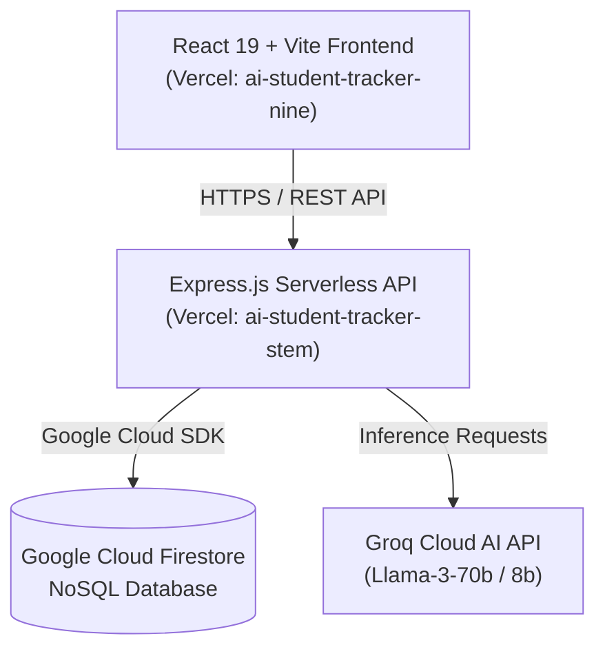

# 🎓 AI Student Tracker

> **A multi-teacher, multi-dimensional academic performance tracker & AI-powered diagnostic remediation platform for secondary school students and educators.**

[](https://ai-student-tracker-nine.vercel.app)
[](https://ai-student-tracker-stem.vercel.app)
[](https://firebase.google.com/)
[-f55036)](https://groq.com/)
[](LICENSE)

* **Live Web App:** [https://ai-student-tracker-nine.vercel.app](https://ai-student-tracker-nine.vercel.app)
* **Production API:** [https://ai-student-tracker-stem.vercel.app](https://ai-student-tracker-stem.vercel.app)
* **GitHub Repository:** [https://github.com/Michael-AI-Dam/AI-Student-tracker](https://github.com/Michael-AI-Dam/AI-Student-tracker)

---

## 📖 The Core Problem & Philosophy

In conventional secondary education, a student's academic standing is often dictated by a single terminal examination. A student who actively participates in class, consistently completes laboratory assignments, and shows steady improvement across weekly quizzes can easily fail an entire term due to a single bad exam day or test anxiety.

**AI Student Tracker replaces single-exam bias with Multi-Dimensional Weighted Composite Mastery.** It records evaluations across five distinct pedagogical dimensions:
1. **Exams (40% Weight)** — Summative mastery assessments.
2. **Tests (20% Weight)** — Periodic milestone assessments.
3. **Quizzes (15% Weight)** — Rapid diagnostic knowledge checks.
4. **Assignments (15% Weight)** — Continuous homework and problem sets.
5. **Participation (10% Weight)** — Classroom engagement, questions asked, and lab participation.

Rather than generic positive reinforcement, the system pairs these metrics with **Groq-accelerated AI Diagnostic Engines (Llama-3)** to deliver honest, data-grounded evaluations, interactive step-by-step micro-learning modules, and adaptive diagnostic practice questions.

---

## 🌟 Key Features & Capabilities

### 👨‍🏫 Teacher Analytics Cockpit
- **Role-Based Subject Isolation:** Teachers select their subject upon login (e.g. Chemistry, Physics, Mathematics, Biology). A teacher's dashboard strictly isolates their classroom domain—preventing subject collision between educators.
- **Class-Wide Assessment Performance Matrix:** Tracks submission counts, class average percentages, and progress badges (`Mastered`, `In Progress`, `Needs Review`) across all 5 assessment types (`Assignment`, `Quiz`, `Test`, `Participation`, `Exam`).
- **Interactive High-Level Metrics:** Clickable summary cards for **Class Size**, **Class Average**, **Total Assessments**, and **Early Intervention Alerts** with detailed drill-down modal views.
- **Permanent Access Code & Cross-Teacher Linking:**
  - When a student is enrolled by any teacher, they receive a single permanent alphanumeric access code.
  - Recognizes equivalent grade levels seamlessly (`SSS 1` $\equiv$ `Grade 10`, `SSS 2` $\equiv$ `Grade 11`, `SSS 3` $\equiv$ `Grade 12`).
  - Subsequent subject teachers adding the same student automatically link to their existing student profile without issuing duplicate codes or requiring multiple signups.
- **Student Roster Management:** Register new students, search and filter roster members, and remove students from classroom rosters safely.
- **Direct Score Recording:** Streamlined assessment grading by selecting the student, choosing the assessment type, and recording the raw score and max possible points.
- **Teacher Account Settings:** In-app modal allowing educators to update their display name, email address, assigned subject, and secure login password.

### 🧑‍🎓 Student Learning & Diagnostic Portal
- **Single Permanent Login:** Students sign up once using their school-issued Access Code and password.
- **Personalized Mastery Dashboard:** Displays their overall weighted composite mastery score, completed assessment count, mastered subject count, and active focus areas.
- **Demonstrated Strengths by Subject:** Expandable subject cards showing performance broken down by assessment type (`Exam`, `Quiz`, `Test`, `Assignment`, `Participation`) matching their verified assessment history with zero confusing topic clutter.
- **Focus & Reinforcement Areas:** Identifies subjects or assessment areas falling below mastery (<60%) with one-click navigation to targeted study modules.
- **Core Subject Competency Breakdown:** Prioritizes foundational subjects (English #1, Mathematics #2) followed by all enrolled sciences, humanities, and technical subjects.
- **Subject-First Assessment History:** Clean tabbed navigation allowing students to select an enrolled subject (e.g., `🧪 Chemistry`, `⚛️ Physics`) to inspect chronological assessment records with exact scores, percentages, and performance badges.
- **⚡ Subject-Specific AI Diagnostics:** Students can trigger an on-demand AI diagnostic assessment tailored specifically to their performance history in the selected subject.
- **📖 Learn with AI Materials:** AI generator synthesizing concept analogies, real-world examples, step-by-step worked calculations, and diagnostic self-check questions for any concept or subject.
- **🎯 Adaptive Practice Quiz:** Generates tailored multiple-choice diagnostic quizzes with contextual hints, instant scoring, and step-by-step answer explanations.

---

## 🛠️ System Architecture & Tech Stack



| Layer | Technology | Hosting / Infrastructure |
|---|---|---|
| **Frontend** | React 19, Vite 8, Modern CSS Variables | [Vercel](https://ai-student-tracker-nine.vercel.app) |
| **Backend API** | Node.js, Express 4, CORS, dotenv | [Vercel Serverless Functions](https://ai-student-tracker-stem.vercel.app) |
| **Database** | Google Cloud Firestore (NoSQL) | Google Cloud Platform (GCP) |
| **AI Diagnostic Engine** | Groq Cloud SDK (`llama-3.3-70b-versatile`) | Groq Ultra-Low Latency Inference |
| **Security & Auth** | bcryptjs password hashing, Access Code validation | Stateless role-based verification |

---

## 📊 Database Architecture (Firestore)

The system is powered by three core Firestore collections:

### 1. `users`
Stores registered educator and student authentication records.
```json
{
  "id": "vXbo2eCYo1LepXt7bUNa",
  "name": "Mr Desmond",
  "email": "desmond@school.edu",
  "password": "<bcrypt_hash>",
  "role": "teacher",
  "subject": "Chemistry",
  "student_id": null,
  "createdAt": "2026-10-17T12:00:00.000Z"
}
```

### 2. `students`
Stores permanent student records across classrooms.
```json
{
  "id": "7iFLaTkdmfZ7R3YG6b4P",
  "name": "Justinah Adedeji",
  "class_name": "SSS 2",
  "teacher_id": "vXbo2eCYo1LepXt7bUNa",
  "teacher_ids": ["vXbo2eCYo1LepXt7bUNa", "QuF7Hq7aC0euzP2DEKaW"],
  "access_code": "9QF9AR",
  "createdAt": "2026-10-17T14:20:21.613Z"
}
```

### 3. `scores`
Stores individual multi-dimensional assessment records.
```json
{
  "id": "mZLaiyC0O1YODP010L7o",
  "student_id": "7iFLaTkdmfZ7R3YG6b4P",
  "teacher_id": "vXbo2eCYo1LepXt7bUNa",
  "subject": "Chemistry",
  "type": "exam",
  "score": 58,
  "max_score": 60,
  "topic": "Exam",
  "createdAt": "2026-10-17T16:07:21.521Z"
}
```

---

## 🔌 API Reference

### Authentication & Profiles
* `POST /api/signup` — Register a new teacher or student account. (Requires valid `access_code` for students).
* `POST /api/login` — Authenticate user. For teachers, updates active `subject`. Returns user payload.
* `POST /api/forgot-password` — Verify email and reset account password.
* `PUT /api/teachers/:teacherId/profile` — Update teacher profile info, subject, and/or password.

### Teachers & Classroom Cockpit
* `GET /api/teachers/:teacherId/students` — Fetch students assigned to this teacher.
* `POST /api/students` — Register a new student or link an existing student across secondary equivalents (`SSS 1` $\equiv$ `Grade 10`). Re-uses permanent `access_code`.
* `POST /api/teachers/remove-student` — Remove a student from a teacher's classroom roster.
* `GET /api/teachers/:teacherId/analytics` — Class analytics: average, distribution, at-risk alerts, and `assessmentTypePerformance` matrix.
* `POST /api/scores` — Record a score entry for a student under the teacher's subject.
* `GET /api/students/:id/profile` — Retrieve student details and assessment scores filtered to the teacher's subject.

### Students & Learning Engines
* `GET /api/students/:id/analytics` — Comprehensive personal analytics: weighted composite score, completed assessments, and subject strengths/weaknesses grouped by assessment type.
* `POST /api/students/:id/recommendations` — Groq AI diagnostic evaluation generated strictly from recorded scores in the requested subject.
* `POST /api/students/:id/personalized-materials` — Synthesizes structured learning units with concept analogies, worked examples, and self-checks.
* `POST /api/students/:id/practice-quiz` — Generates a 3-question adaptive multiple-choice quiz with explanations and hints.

---

## ⚡ Running Locally

### Prerequisites
* **Node.js:** v18.0.0 or higher
* **npm:** v9.0.0 or higher
* **Groq API Key:** [Get an API key from Groq Console](https://console.groq.com/)
* **Firebase Service Account:** GCP Firestore credentials

### 1. Clone Repository
```bash
git clone https://github.com/Michael-AI-Dam/AI-Student-tracker.git
cd AI-Student-tracker
```

### 2. Backend Setup
```bash
cd student-tracker-backend
npm install
```
Create a `.env` file in `student-tracker-backend/`:
```env
PORT=5000
GROQ_API_KEY=your_groq_api_key_here
# Optional: Firebase config / GCP credentials
FIREBASE_PROJECT_ID=your_project_id
```
Start the backend development server:
```bash
npm run dev
# Server running at http://localhost:5000
```

### 3. Frontend Setup
In a new terminal:
```bash
cd student-tracker-frontend
npm install
```
Create a `.env` file in `student-tracker-frontend/`:
```env
VITE_API_URL=http://localhost:5000
```
Start the frontend development server:
```bash
npm run dev
# Frontend running at http://localhost:5173
```

---

## 🧭 Project Status: What the App Can & Cannot Do

### ✅ What the App CAN Do (Current Capabilities)
- Multi-teacher classroom isolation (teachers only see and grade their own subject).
- Single permanent student access code across all teachers and subjects.
- Automated recognition of equivalent secondary class names (`SSS 1-3` $\leftrightarrow$ `Grade 10-12`).
- 5-dimensional weighted assessment tracking (`Exam`, `Test`, `Quiz`, `Assignment`, `Participation`).
- Class-wide performance breakdowns by assessment type with automated mastery status.
- Student performance and strength tracking by assessment type matching historical grades.
- Subject-first assessment history tables with dedicated subject tabs.
- On-demand AI diagnostic evaluations based strictly on verified assessment data.
- AI micro-learning module generator and adaptive 3-question practice quiz engine.
- Teacher profile settings with password update capabilities.
- Live, production-ready serverless deployments on Vercel backed by Google Cloud Firestore.

### ⚠️ What the App CANNOT Do Yet (Current Limitations)
- **No Automated SMS/WhatsApp Alerts:** Early intervention warnings are visible in the teacher cockpit but not automatically dispatched to guardians via SMS/WhatsApp.
- **No Bulk CSV Upload:** Teachers currently enter students and scores through structured forms rather than uploading an entire spreadsheet.
- **No PDF/Excel Gradebook Export:** Roster and assessment records cannot yet be exported directly into printable PDF report cards or Excel sheets.
- **No Parent/Guardian Portal:** Only Teacher and Student roles are active; parent observer accounts are not yet implemented.
- **No Real-Time WebSocket Sockets:** Updates are fetched asynchronously on action rather than pushed via live WebSockets.
- **No Full Offline/PWA Sync:** Requires an active internet connection to authenticate and communicate with Firestore.

---

## 🚀 Upcoming Features Roadmap

* [ ] **Parent & Guardian Observer Portal:** Dedicated access code allowing parents to monitor their child's composite progress across all subjects without editing permissions.
* [ ] **Bulk CSV Roster & Score Import:** Upload class rosters and term assessment sheets via CSV/Excel in a single click.
* [ ] **Termly PDF Report Card Generator:** Download official, branded student term report cards with composite rankings, teacher remarks, and AI diagnostic summaries.
* [ ] **Automated SMS & WhatsApp Intervention Alerts:** Connect Twilio/Termii gateways to alert parents when a student's composite falls into the "Needs Support" tier.
* [ ] **School Administrator / Principal Dashboard:** School-wide bird's-eye view tracking cross-departmental subject averages, teacher activity, and grade distribution across all secondary classes.
* [ ] **Progressive Web App (PWA) Offline Mode:** Offline score drafts with automated background synchronization upon network reconnection.

---

## 👨‍💻 Author & Contributions

* **Author:** Michael Oluwadamilare ([@Michael-AI-Dam](https://github.com/Michael-AI-Dam))
* **Repository:** [https://github.com/Michael-AI-Dam/AI-Student-tracker](https://github.com/Michael-AI-Dam/AI-Student-tracker)

Contributions, feature suggestions, and educational institution feedback are warmly welcome! Feel free to open an issue or submit a pull request.
