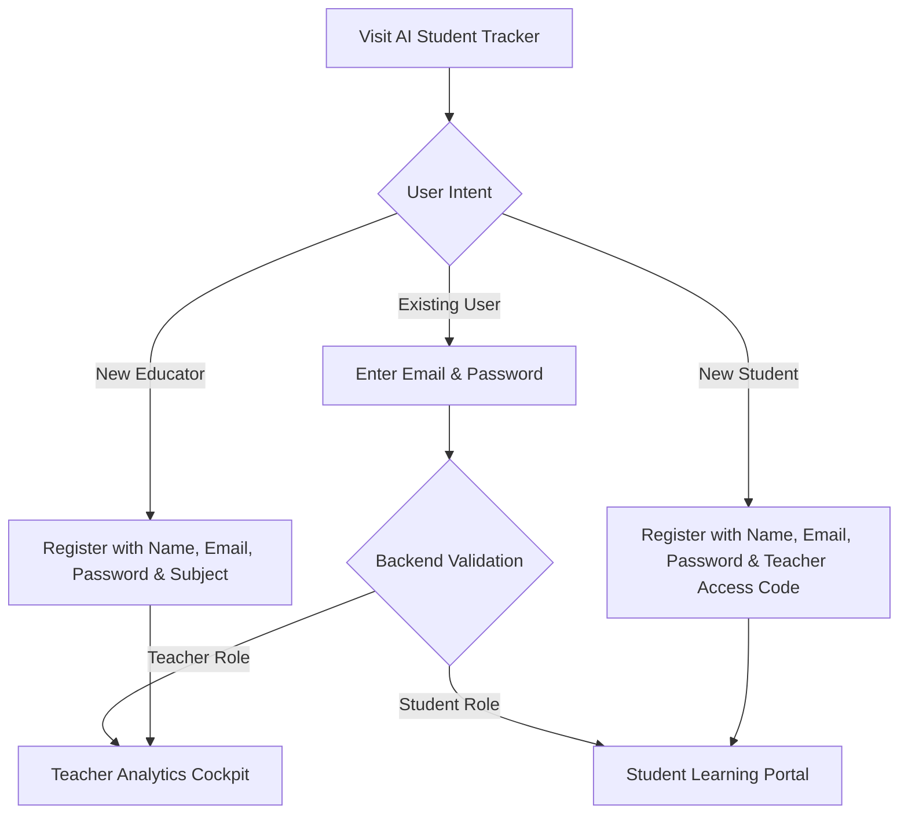

# 📘 AI Student Tracker — Platform User Guide

Welcome to **AI Student Tracker**, an intelligent academic analytics and personalized diagnostic platform designed for secondary school educators and learners.

This guide provides step-by-step instructions for both **Teachers** and **Students** to help you get the most out of the system.

---

## 📑 Table of Contents
1. [Core Concept: Multi-Dimensional Mastery](#1-core-concept-multi-dimensional-mastery)
2. [Getting Started & Authentication](#2-getting-started--authentication)
   - [Teacher Registration](#teacher-registration)
   - [Student Registration](#student-registration)
   - [Logging In](#logging-in)
3. [Teacher Analytics Cockpit Guide](#3-teacher-analytics-cockpit-guide)
   - [Dashboard Metrics & Summary Cards](#dashboard-metrics--summary-cards)
   - [Assessment Performance Matrix](#assessment-performance-matrix)
   - [Managing Student Rosters & Permanent Access Codes](#managing-student-rosters--permanent-access-codes)
   - [Cross-Teacher Student Linking](#cross-teacher-student-linking)
   - [Recording Student Assessments](#recording-student-assessments)
   - [Removing a Student](#removing-a-student)
   - [Teacher Profile & Subject Settings](#teacher-profile--subject-settings)
4. [Student Learning Portal Guide](#4-student-learning-portal-guide)
   - [Personal Mastery Dashboard](#personal-mastery-dashboard)
   - [Core Subject Competency Breakdown](#core-subject-competency-breakdown)
   - [Subject-First Assessment History](#subject-first-assessment-history)
   - [Generating Subject-Specific AI Diagnostics](#generating-subject-specific-ai-diagnostics)
   - [Learn with AI (Micro-Learning Modules)](#learn-with-ai-micro-learning-modules)
   - [Adaptive Practice Quizzes](#adaptive-practice-quizzes)
5. [Mastery Formula & Grading Weights](#5-mastery-formula--grading-weights)
6. [Frequently Asked Questions (FAQ)](#6-frequently-asked-questions-faq)

---

## 1. Core Concept: Multi-Dimensional Mastery

Traditional grading systems often rely solely on one or two high-stakes exams, which can produce an incomplete or biased picture of a student's actual learning progress. 

**AI Student Tracker** evaluates academic mastery across **five continuous pedagogical dimensions**:

| Assessment Type | Weight | Pedagogical Purpose |
|---|:---:|---|
| **Exams** | **40%** | Comprehensive summative evaluation of overall subject retention. |
| **Tests** | **20%** | Periodic milestone checks evaluating mid-term module mastery. |
| **Quizzes** | **15%** | Low-stakes, frequent diagnostic knowledge checks. |
| **Assignments** | **15%** | Continuous homework, practice problem sets, and lab write-ups. |
| **Participation** | **10%** | Active classroom engagement, curiosity, and group collaboration. |

$$\text{Composite Mastery} = \sum (\text{Assessment Type Average} \times \text{Weight})$$

---

## 2. Getting Started & Authentication

The web application is accessible on any desktop, tablet, or smartphone browser:
- **Live Application URL:** [https://ai-student-tracker-nine.vercel.app](https://ai-student-tracker-nine.vercel.app)

### Teacher Registration
1. Click the **Sign Up** tab on the home screen.
2. Enter your **Full Name**, **Email Address**, and secure **Password** (min. 6 characters).
3. Under **I am registering as:** select **Teacher (Classroom Analytics Cockpit)**.
4. Select your **Subject Taught** from the dropdown:
   - *Physics, Chemistry, Mathematics, Biology, English, Economics, Geography, Agricultural Science, Civic Education, Computer Science, Animal Husbandry, History.*
5. Click **Create Account**. You will be directed immediately to your Teacher Cockpit.

### Student Registration
1. Click the **Sign Up** tab.
2. Enter your **Full Name**, **Email Address**, and **Password**.
3. Under **I am registering as:** select **Student (Personal Learning Portal)**.
4. Enter the unique **6-Character Access Code** given to you by your teacher (e.g., `NG7YLD`).
5. Click **Create Account** to enter your personalized learning dashboard.

### Logging In
- Once registered, you do **not** need to re-select your role or subject.
- Simply enter your **Email Address** and **Password** and click **Sign In to Dashboard**. The backend automatically detects your account type and loads your specific subjects and permissions.

---

## 3. Teacher Analytics Cockpit Guide

The Teacher Cockpit isolates your classroom domain so that only assessments and metrics belonging to your assigned subject are displayed.

### Dashboard Metrics & Summary Cards
At the top of the Analytics tab, four high-level overview cards summarize your classroom status:
- **Class Size:** Total number of students currently registered in your class roster.
- **Class Average:** The combined average percentage of all recorded scores in your subject.
- **Total Assessments:** Cumulative count of all individual scores submitted across assignments, tests, quizzes, and exams.
- **Early Intervention Alerts:** Count of students currently maintaining a composite mastery below 60%.

> **Tip:** **Click any summary card** to open an interactive modal with a detailed student-by-student drilldown.

---

### Assessment Performance Matrix
A class-wide evaluation table groups all submissions strictly by **Assessment Type**:

1. **Assessment Type:** Assignment, Quiz, Test, Participation, or Exam.
2. **No. of Student Records:** Count of completed submissions under that category.
3. **Class Average:** Real-time average score percentage across all students.
4. **Status Level:**
   - 🟢 **Mastered:** Average $\ge 75\%$
   - 🟡 **In Progress:** Average between $60\% - 74\%$
   - 🔴 **Needs Review:** Average $< 60\%$

---

### Managing Student Rosters & Permanent Access Codes

#### Adding a New Student
1. Navigate to the **Manage Roster** or **Class Roster** section.
2. Fill in the **Student Full Name** (e.g., `Raymond Philip`).
3. Select or enter their **Class / Grade Level** (e.g., `SSS 1`, `SSS 2`, `SSS 3`, or `Grade 10`, `Grade 11`, `Grade 12`).
4. Click **Register Student**.
5. The system automatically creates their profile and generates a **Permanent 6-Character Access Code** (e.g., `NG7YLD`). Share this code with the student so they can activate their student account.

#### Cross-Teacher Student Linking
- Students belong to multiple subjects taught by different teachers.
- If Mrs. Suzana (Physics Teacher) registers `Raymond Philip` in `SSS 1`, he receives code `NG7YLD`.
- When Mr. Desmond (Chemistry Teacher) adds `Raymond Philip` in `SSS 1` (or `Grade 10`), **the system automatically links Mr. Desmond to Raymond's existing profile**.
- Raymond **keeps his original permanent access code** (`NG7YLD`). No duplicate student accounts are created.

#### Recording Student Assessments
1. Open the **Record Assessment** tab.
2. Select the student's name from your classroom roster.
3. Choose the **Assessment Type** (`Assignment`, `Quiz`, `Test`, `Participation`, or `Exam`).
4. Enter the **Score Obtained** and the **Max Possible Score** (e.g., `18 / 20` or `85 / 100`).
5. Click **Submit Assessment Record**. The score is recorded instantly into Firestore and updates both your classroom analytics and the student's personal report.

#### Removing a Student
- If a student changes classes or transfers, click the **Remove Student** (trash can) button next to their name in your roster table.
- Confirm the action in the prompt. This safely unlinks the student from your classroom list without deleting school-wide student data.

#### Teacher Profile & Subject Settings
1. Click the **⚙️ Settings** icon in the upper right header.
2. In the modal, you can:
   - Edit your display name.
   - Update your contact email.
   - Switch your assigned subject (e.g., switching from Physics to Computer Science).
   - Change your account password.
3. Click **Save Changes**.

---

## 4. Student Learning Portal Guide

The Student Learning Portal provides honest, data-driven academic visibility and AI-powered study assistance.

### Personal Mastery Dashboard
- **Overall Composite Score:** Displays your weighted academic mastery percentage across all enrolled subjects.
- **Mastered Subjects:** Total count of subjects where your mastery is 75% or higher.
- **Focus Areas:** Highlights subject areas requiring immediate attention before upcoming exams.

---

### Core Subject Competency Breakdown
- Foundational core subjects are prioritized at the top of your overview:
  1. 📖 **English Language**
  2. 📐 **Mathematics**
  3. Other Sciences, Humanities, and Technical Subjects (`⚛️ Physics`, `🧪 Chemistry`, `💻 Computer Science`, `🌱 Agricultural Science`, etc.)
- Expand any subject card to see your exact performance broken down by assessment type (`Exam`, `Quiz`, `Test`, `Assignment`, `Participation`) with clear progress bars and percentage badges.

---

### Subject-First Assessment History
1. Scroll to the **Assessment Records** tab.
2. Select any enrolled subject pill button (e.g., `🧪 Chemistry (4)` or `⚛️ Physics (3)`).
3. Inspect every recorded grade in chronological order:
   - Date recorded
   - Assessment category
   - Raw score and maximum points
   - Percentage score and status badge (`Mastered`, `In Progress`, `Needs Review`)

---

### Generating Subject-Specific AI Diagnostics
Under each subject's history tab:
1. Click the **⚡ Run AI Subject Diagnostic** button.
2. The AI diagnostic engine reads your actual recorded grades in that subject and produces a tailored, honest evaluation:
   - Identified conceptual strengths.
   - Specific assessment areas dragging your average down (e.g., low quiz scores despite high test scores).
   - Concrete 3-step action roadmap for improvement.

---

### Learn with AI (Micro-Learning Modules)
Struggling with a specific concept in class?
1. Navigate to the **Learn with AI** section.
2. Enter any concept or topic name (e.g., *Stoichiometry*, *Newton's Second Law*, *Binary Search Trees*, *Digestive System in Ruminants*).
3. Click **Generate Study Guide**.
4. The AI breaks down the concept into:
   - **Plain English Concept Analogy**
   - **Real-World Application Example**
   - **Step-by-Step Worked Problem / Calculation**
   - **Self-Check Diagnostic Questions** with hidden answers

---

### Adaptive Practice Quizzes
1. Click on **Adaptive Practice Quiz**.
2. Select your target subject and difficulty level.
3. Answer the 5 generated diagnostic multiple-choice questions.
4. Submit your answers to receive instant scoring, detailed step-by-step explanations for each question, and targeted review tips.

---

## 5. Mastery Formula & Grading Weights

$$\begin{aligned}
\text{Total Weighted Score} &= (\text{Exam Avg} \times 0.40) \\
&+ (\text{Test Avg} \times 0.20) \\
&+ (\text{Quiz Avg} \times 0.15) \\
&+ (\text{Assignment Avg} \times 0.15) \\
&+ (\text{Participation Avg} \times 0.10)
\end{aligned}$$

### Performance Badging Thresholds
- 🟢 **Mastered (75% – 100%):** Demonstrates strong conceptual retention and execution across assessments.
- 🟡 **In Progress (60% – 74%):** Shows foundational grasp, but needs targeted reinforcement in quizzes or problem sets.
- 🔴 **Needs Review (< 60%):** Flags an early intervention alert requiring personalized teacher review or diagnostic practice.

---

## 6. Frequently Asked Questions (FAQ)

#### Q: What if a teacher registers a student who already has an account?
**A:** As long as the student is registered with the same full name and class grade (e.g. `SSS 1` or `Grade 10`), the backend automatically identifies the student and connects the new subject to their existing profile. The student keeps their single permanent access code.

#### Q: Can a student see another student's scores?
**A:** No. Student portals are private and secured. Students only have visibility into their own individual records and AI diagnostics.

#### Q: How do teachers switch or update the subject they teach?
**A:** Teachers can open the **Settings modal** (gear icon in the top navigation) and select a new subject from the dropdown. All analytics will immediately reload to match the new subject.

#### Q: What happens if an educator records an assessment out of order?
**A:** The platform automatically standardizes the arrangement across all dashboards into:  
`Assignment` $\rightarrow$ `Quiz` $\rightarrow$ `Test` $\rightarrow$ `Participation` $\rightarrow$ `Exam`.  
Scores are always organized consistently regardless of the sequence in which they were entered.

---

*AI Student Tracker — Designed for educators, built for learners.*
